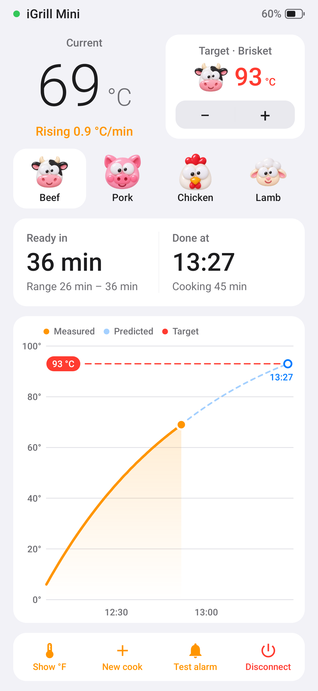
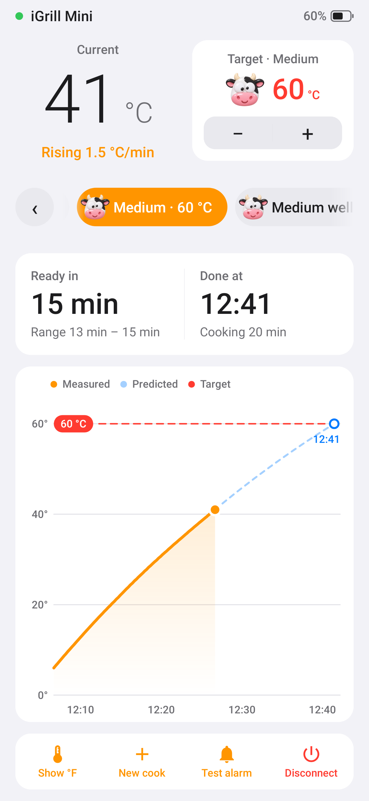
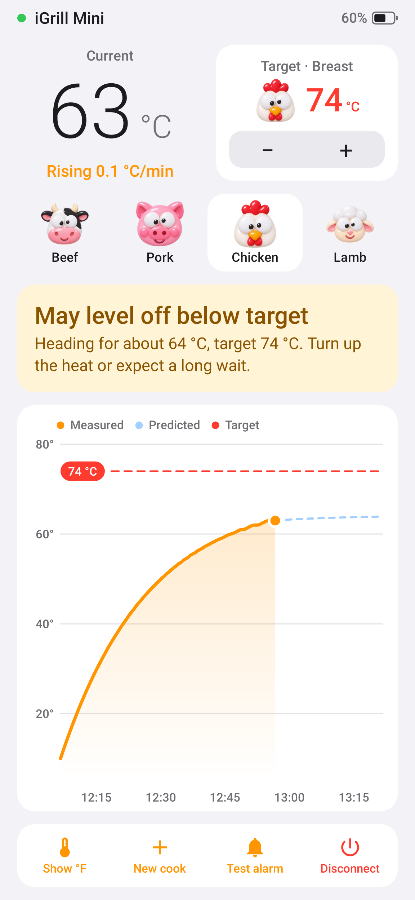
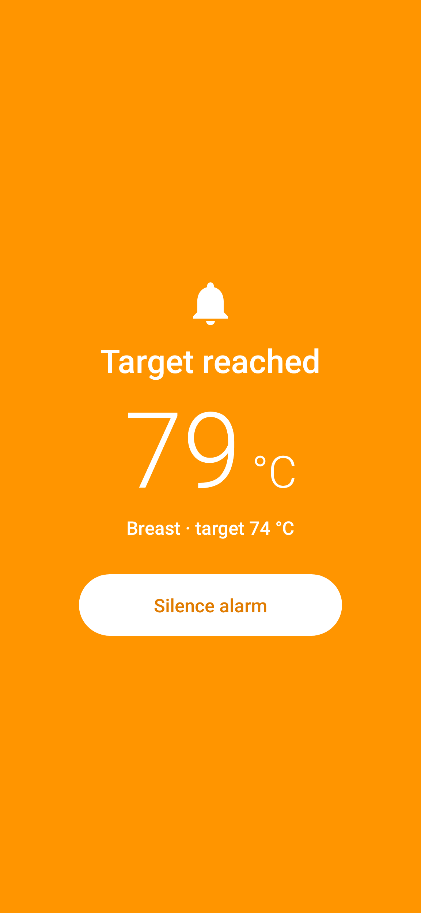

# Grill Probe

An Android app for the Weber iGrill Mini that tells you when your food will be ready.

The official app shows the temperature. Grill Probe also predicts the finish: it fits a heating curve to the probe readings and gives you "ready in 36 min, done at 13:27", warns you when the cook is levelling off below your target, and sounds a proper alarm when the target is reached, even with the phone locked.

<p>
  
  
  
  
</p>

The screenshots are rendered by the unit tests from simulated cooks, so they always match the current build.

## Features

- Connects straight to the iGrill over Bluetooth. No account, no cloud, no PC.
- Keeps monitoring in the background with the screen off, with the live temperature and finish time in a notification.
- Presets for beef, pork, chicken and lamb, or any custom target.
- Finish time from a heating-curve fit, with a range, plus warnings when the cook stalls or will level off below target.
- Full-screen alarm with sound and vibration, which you can silence from the lock screen.
- °C or °F.

## How the prediction works

Meat in an oven or grill heats roughly like Newton's law of heating: it rises towards the cooking temperature and slows down as it gets closer. Grill Probe fits that curve to the readings since heating started, weighting recent minutes more, and solves for when it crosses your target. Until the curve has enough bend to beat a straight line it uses the recent trend instead. The rate only looks at readings since the last peak or dip, so probing something hot and then cooling does not confuse it.

## Supported devices

Tested on the iGrill Mini. The iGrill Mini 2, iGrill 2 and iGrill 3 use the same protocol and should work; the app reads the first port with a probe plugged in. Needs Android 12 or newer.

## Building

```sh
./gradlew detekt lintDebug :lint-rules:test testDebugUnitTest assembleDebug
```

On Windows, `build.bat` runs the same checks and copies the APK next to the project, and `deploy.bat` builds, installs on the connected phone and launches it.

The build is strict on purpose: detekt with every rule, ktlint formatting, Android Lint with warnings as errors, Kotlin warnings as errors, a 400-line limit per file and no comments in source.

## Releases

Run the **Release** workflow from the Actions tab. It runs every check, builds a signed APK and publishes it as a GitHub release.

## Thanks

The Bluetooth protocol comes from the reverse-engineering work in [bendikwa/igrill](https://github.com/bendikwa/igrill) and [1mckenna/esp32_iGrill](https://github.com/1mckenna/esp32_iGrill).

Not affiliated with or endorsed by Weber. iGrill is a trademark of its owner.
